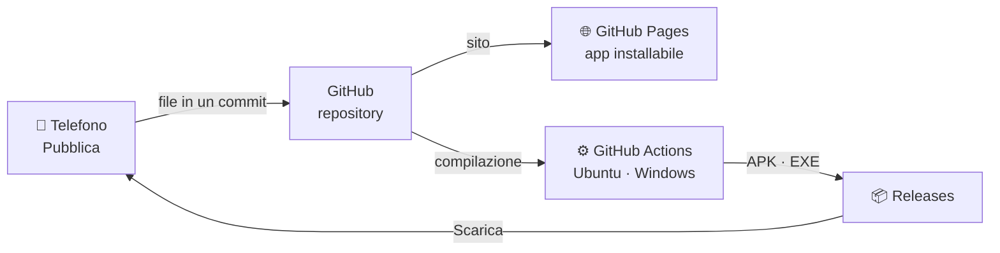

# PUBBLICA

**GitHub dal telefono · APK ed EXE senza un PC**

---

Pubblica è **una sola pagina web** che si installa come app sul telefono. Con lei:

- **pubblichi** i tuoi progetti su GitHub scegliendo uno ZIP;
- **compili** script Python e app HTML in **app Android (APK)** e **programmi Windows (EXE)**;
- **controlli e ripari** il sito GitHub Pages di un progetto;
- **gestisci** i repository: li crei, li svuoti, li elimini o li installi in Termux.

Il lavoro pesante lo fa GitHub, gratis: il telefono invia solo i file e ti mostra l'avanzamento.

## Il menu

| | Voce | Cosa fa |
|---|---|---|
| 🚀 | **Pubblica su GitHub** | Scegli uno ZIP, dei file o una cartella. Pubblica mostra cosa aggiunge, modifica e toglie, poi invia tutto in **un solo commit** (tutto o niente). |
| 🛠️ | **Compila** | 📱 APK da Python o HTML · 🐍 APK con Kivy · 🪟 EXE per Windows |
| 🌐 | **Sito e PWA** | Apri il sito · Rendi il sito installabile · 🩺 Controlla e ripara · Collegamenti |
| 🗂️ | **Repository** | Apri su GitHub · Crea · Svuota · 💻 Installa in Termux · Elimina |
| ⚙ | **Impostazioni** | L'icona in alto a sinistra: token, repository, preferenze |

## In 30 secondi

1. **⚙ Impostazioni → Accesso**: tocca «Chiedi il token a GitHub». Si apre GitHub con nome e permessi già compilati: crea il token e incollalo. Serve una volta sola.
2. **⚙ Impostazioni → I tuoi repository**: aggiungi i progetti (per esempio `baudinolorenzo73/lollolab`).
3. Dal menu scegli cosa fare. Ogni passaggio ti dice cosa sta succedendo e, se qualcosa va storto, come rimediare.

## Le funzioni

### 🚀 Pubblica su GitHub
- Accetta ZIP, file sparsi o una cartella (anche da Google Drive, dal selettore di Android).
- **Anteprima** delle differenze prima di inviare; nota per il commit facoltativa.
- Controlla la versione: se lo ZIP è **più vecchio** di quello online, la pubblicazione si ferma.
- Rifiuta i file con **chiavi segrete** (`.env`, `.pem`, keystore…) e non tocca mai `CNAME`, `.nojekyll` e la cartella `firma/`.
- Con `__patch_only__.txt` nello ZIP invia solo i file modificati e lascia gli altri.

### 🛠️ Compila
| | Da | A | Dove compila |
|---|---|---|---|
| 📱 | Script Python (print/input), progetto ZIP, app HTML | APK Android | GitHub Actions · Ubuntu (Buildozer / Capacitor) |
| 🐍 | App con interfaccia Kivy | APK Android | GitHub Actions · Ubuntu (Buildozer) |
| 🪟 | Script `.py`, app HTML (`.html` o ZIP) | EXE Windows | GitHub Actions · Windows (PyInstaller; le app HTML con pywebview + WebView2) |

**🪟 EXE per Windows** in dettaglio:
- accetta **script Python** e **app HTML**: capisce da solo cos'è (con `index.html` è un'app HTML; se nello ZIP ci sono sia pagine sia `.py`, te lo chiede);
- le **app HTML** si aprono in una **finestra di Windows** con il motore di Edge (WebView2): titolo dalla `<title>` della pagina, larghezza e altezza a scelta, schermo intero facoltativo. Un piccolo server interno serve le pagine su `http://127.0.0.1`, così moduli JavaScript, `fetch` e salvataggi (`localStorage`) funzionano come online, e i dati restano tra un avvio e l'altro. Se sul PC manca WebView2 (raro: c'è in Windows 10 e 11 aggiornati), l'app si apre nel browser predefinito;
- legge il codice e trova da solo le **librerie** (`import PIL` → `pillow`, `import cv2` → `opencv-python`…) e se il programma apre una **finestra** (tkinter, PyQt, pygame…) o usa la **console**;
- **un solo `.exe`** oppure ZIP con la cartella; icona tua (PNG/ICO) o automatica con le iniziali;
- l'EXE ha le **proprietà di Windows** compilate (nome, versione, «by Lollo ®2026») e un file **`.sha256`** per controllare che il download sia integro;
- crea da solo il **repository dedicato** (`utente/nome-exe`); la **versione sale da sola** se ricompili con il programma cambiato;
- le librerie restano in **cache** su GitHub, quindi le ricompilazioni sono più veloci;
- a fine compilazione: **Scarica EXE**, «Copia il link per il PC» o **📤 Manda il link al PC** (WhatsApp, Telegram, email). Se fallisce, vedi il passaggio sbagliato, un suggerimento e il log.

> Sul PC, al primo avvio Windows può dire «Windows ha protetto il PC»: **Ulteriori informazioni → Esegui comunque**. Succede con tutti i programmi non firmati.

### 🌐 Sito e PWA
- **Apri il sito**: apre la pagina GitHub Pages del progetto (se Pages è spento, lo attiva).
- **Rendi il sito installabile**: aggiunge manifest, service worker e icone, solo se mancano e dopo la tua conferma.
- **🩺 Controlla e ripara**: verifica ramo, Pages, pagina iniziale, riferimenti, manifest, service worker e icone. Mostra le **correzioni sicure** e le applica solo dopo conferma, senza mai cancellare file.

### 🗂️ Repository
- Crea, svuota, elimina (per eliminare devi scrivere «ELIMINA» e il nome del repository: niente cancellazioni per sbaglio).
- **💻 Installa in Termux**: spunti i repository e Pubblica prepara il comando `installa-repo`, che li scarica in `~/progetti`, installa `requirements.txt` e crea un comando per avviarli.

### 📥 Condividi con Pubblica
Da qualsiasi app (file manager, Telegram, Gmail, Drive) tocca **Condividi → Pubblica** su uno ZIP, un `.py` o una pagina `.html`. Pubblica si apre e chiede cosa farne:

| File | Scelte |
|---|---|
| `.zip` | Pubblica · EXE · APK da progetto Python · APK da sito HTML |
| `.py` | Pubblica · EXE · APK da Python |
| `.html` | Pubblica · EXE · APK da app HTML |

*Pubblica compare nel menu «Condividi» solo dopo averla installata come app.*

### 🔔 Notifiche
Al primo tocco su «Compila», Pubblica chiede il permesso per le notifiche. Puoi uscire dall'app: quando l'APK o l'EXE è pronto (o se la compilazione non riesce) arriva una notifica, e toccandola torni a Pubblica.

## Il token GitHub

| Per… | Token classico | Token fine-grained |
|---|---|---|
| Pubblicare | `repo` | Contents: Read and write |
| Creare / eliminare repository | `repo`, `delete_repo` | Administration: Read and write |
| Compilare APK ed EXE | `repo`, `workflow` | Contents, Workflows, Actions: Read and write |

In **⚙ Impostazioni → Accesso**, il pulsante «Controlla il mio token» dice cosa manca.

## Installare Pubblica (una volta sola)

1. Su GitHub crea il repository `pubblica` e attiva **Pages** sul ramo principale, cartella `/ (root)`.
2. Carica lì il contenuto di questo ZIP.
3. Dopo 1–3 minuti apri `https://baudinolorenzo73.github.io/pubblica/` e tocca **📲 Installa**.

## Aggiornare Pubblica

1. Aumenta il numero in `versione.js` **e** in `versione.json` (es. da `3.16.0` a `3.16.1`). Senza questo passo i telefoni non vedono l'aggiornamento.
2. Pubblica il nuovo ZIP con Pubblica stessa.
3. Alla riapertura compare **⬆ Aggiorna alla 3.16.1** (oppure tocca **↻ Controlla aggiornamenti**).

## Come è fatta

| File | A cosa serve |
|---|---|
| `index.html` | Tutta l'app: interfaccia, Pubblica, Crea APK, EXE, Controlla e ripara (CSS e JavaScript inclusi, nessuna libreria da internet) |
| `versione.js` | Il numero di versione: lo leggono la pagina e il service worker |
| `versione.json` | Lo stesso numero, per il controllo «origine più vecchia» |
| `sw.js` | Service worker: uso senza rete, aggiornamenti, file ricevuti da «Condividi», tocco sulle notifiche |
| `manifest.webmanifest` | Nome, colori, icone e voce «Condividi» per l'installazione |
| `icone/` | Icone dell'app (anche la versione «maskable» per Android) |

Le richieste a GitHub non passano mai dalla cache: Pubblica vede sempre lo stato reale del repository.

## Sicurezza e privacy

- Pubblica parla **solo con GitHub** (e con PyPI, per cercare i nomi delle librerie Python): nessun altro server, nessuna statistica.
- Il token resta **sul tuo telefono**.
- ⚠ Tutte le tue app su `baudinolorenzo73.github.io` condividono la memoria del browser: se fai ricordare il token, anche le altre pagine di quel dominio potrebbero leggerlo. Pubblica i siti di altri su un altro account o dominio.
- Le regole di sicurezza della pagina (Content-Security-Policy) permettono connessioni solo verso GitHub, i suoi server di file e PyPI.

## Novità

### 3.16
- **🪟 App HTML → EXE**: una pagina `.html` o un progetto ZIP con `index.html` diventa un programma Windows che si apre nella sua finestra (motore di Edge). Dati salvati che restano, funziona offline, titolo e dimensioni della finestra a scelta.
- «Condividi» di una pagina `.html` propone anche **EXE per Windows**.

### 3.15
- **📥 Condividi con Pubblica**: da qualsiasi app, ZIP, `.py` e `.html` arrivano a Pubblica, che propone Pubblica / EXE / APK.
- **🔔 Notifiche** quando l'APK o l'EXE è pronto (o la compilazione non riesce), anche con l'app chiusa in secondo piano.
- **EXE**: proprietà del file in Windows (nome, versione, «by Lollo ®2026»), impronta `.sha256`, cache delle librerie (ricompilazioni più veloci), pagina della release con le istruzioni per il PC, pulsante **📤 Manda il link al PC**.
- README nuovo.

### 3.14
- **🪟 EXE per Windows** nel menu Compila: da script `.py` o progetto ZIP a programma `.exe` con PyInstaller su GitHub Actions (Windows).

### 3.13
- **Grafica cyberpunk** (neon ciano e magenta, icone nuove) e **menu snello** a quattro voci con sottomenu; ⚙ Impostazioni in alto a sinistra.

### 3.12
- 3.12.1 · **Controlla e ripara** più affidabile: niente più dati vecchi dalla cache del browser, controllo che si rifà da solo, icona per iOS solo se il file esiste.
- 3.12 · Le **API gratuite** diventano un'app separata (`api`): Pubblica pesa quasi la metà.

<b>Versioni precedenti (3.0 – 3.11)</b>

- **3.11** · Crea APK con Kivy, per app che hanno già la loro interfaccia Kivy.
- **3.10** · 🩺 Controlla e ripara. 3.10.1–3.10.3: «Rendi il sito installabile» sempre visibile; workflow APK su Ubuntu 22.04 con Buildozer 1.5.0, python-for-android v2024.01.21, NDK 25b e API 33.
- **3.9** · API IA gratuite (poi spostate nell'app `api`).
- **3.8** · 💻 Installa in Termux e 📲 Rendi il sito installabile.
- **3.7** · API gratuite e Trekking/GPX (poi spostate nell'app `api`); aggiornamento dall'app per gli APK HTML.
- **3.6** · L'APK prende il nome dell'app; un nuovo progetto parte pulito.
- **3.5** · Controllo automatico dell'APK a fine compilazione e riquadro «Non si installa?».
- **3.4** · Nome dell'APK come il repository.
- **3.3** · 🔑 «Chiedi il token a GitHub» con permessi già compilati e «Controlla il mio token».
- **3.2** · Librerie Python cercate in automatico su PyPI; download funzionanti nelle app HTML.
- **3.0 / 3.1** · 📱 Crea APK (Python o HTML) e 🗺️ Apri il sito.

## Grazie a

[PyInstaller](https://pyinstaller.org) · [Buildozer](https://github.com/kivy/buildozer) e [python-for-android](https://github.com/kivy/python-for-android) · [Capacitor](https://capacitorjs.com) · [JSZip](https://stuk.github.io/jszip/) · [GitHub Actions](https://docs.github.com/actions) e [GitHub Pages](https://pages.github.com)

**by Lollo ®2026**

